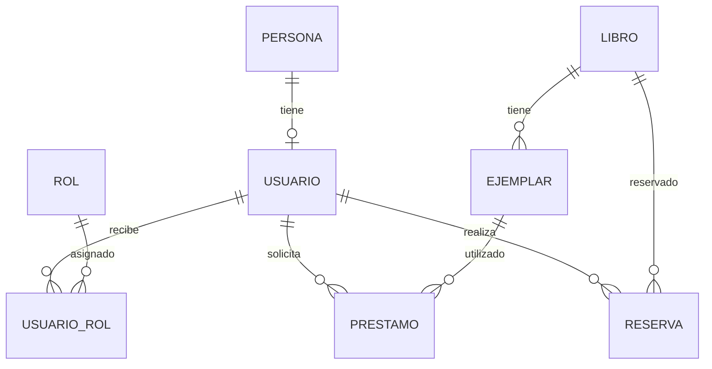

# Sistema Bibliotecario

Laboratorio 01 de Construcción y Evolución del Software: modelo de datos al primer CRUD REST. Implementación del contenido de `Laboratorio01_Comandos.docx` con NestJS, TypeORM y PostgreSQL 17 en Docker.

## 1. Requisitos

Visual Studio Code, Git, Node.js 22 o superior, npm y Docker Desktop iniciado. DBeaver y Postman son opcionales.

## 2. Repositorio y ramas

```powershell
git clone https://github.com/caorrico/Laboratorio01Construcci-n.git
cd Laboratorio01Construcci-n
git switch desarrollo
git branch -a
```

El repositorio contiene las ramas `master`, `pruebas` y `desarrollo`.

## 3. Configurar PostgreSQL

Desde la raíz:

```powershell
Copy-Item .env.example .env
# Editar .env y definir POSTGRES_PASSWORD con la contraseña local.
docker version
docker compose up -d
docker compose ps
docker compose exec postgres psql -U biblioteca -d biblioteca_db
```

En `psql`, crear las tablas ejecutando el contenido de `database/01_schema.sql` en este orden: `persona`, `usuario`, `rol`, `usuario_rol`. Para cargar el archivo sin copiarlo manualmente, salir de psql con `\q` y ejecutar:

```powershell
docker cp ./database/01_schema.sql biblioteca-postgres:/tmp/01_schema.sql
docker compose exec postgres psql -U biblioteca -d biblioteca_db -v ON_ERROR_STOP=1 -f /tmp/01_schema.sql
```

Ejecutar la creación de tablas una sola vez en la base vacía. Docker usa `postgres:17`, contenedor `biblioteca-postgres`, puerto `5434`, base `biblioteca_db`, usuario `biblioteca` y volumen `biblioteca_pgdata`, como en la guía. Conectar DBeaver a `localhost:5434` con esos datos y la contraseña de `.env`.

## 4. Ejecutar NestJS

```powershell
cd backend
npm ci
npm run build
npm run start:dev
```

Abrir http://localhost:3000. El recurso es http://localhost:3000/persona. TypeORM usa el esquema SQL existente (`synchronize: false`); la contraseña se lee del `.env` de la raíz.

## 5. Probar el CRUD mediante PowerShell

Con NestJS ejecutándose, abrir otra terminal:

```powershell
$persona = @{
    nombres = "Ana"
    apellidos = "Perez"
    identificacion = "PRUEBA-001"
    correo = "ana.prueba@example.com"
    telefono = "0991234567"
} | ConvertTo-Json

Invoke-RestMethod -Uri "http://localhost:3000/persona" -Method Post -ContentType "application/json" -Body $persona
Invoke-RestMethod -Uri "http://localhost:3000/persona" -Method Get

$persona = Invoke-RestMethod -Uri "http://localhost:3000/persona" -Method Get
$id = ($persona | Where-Object { $_.identificacion -eq "PRUEBA-001" }).id_persona
Invoke-RestMethod -Uri "http://localhost:3000/persona/$id" -Method Get

$datos = @{ telefono = "0987654321" } | ConvertTo-Json
Invoke-RestMethod -Uri "http://localhost:3000/persona/$id" -Method Patch -ContentType "application/json" -Body $datos
Invoke-RestMethod -Uri "http://localhost:3000/persona/$id" -Method Get
Invoke-RestMethod -Uri "http://localhost:3000/persona/$id" -Method Delete

try {
    Invoke-RestMethod -Uri "http://localhost:3000/persona/$id" -Method Get
} catch {
    Write-Host "Código HTTP:" ([int]$_.Exception.Response.StatusCode)
    Write-Host "Detalle:" $_.ErrorDetails.Message
}

$datos = @{
    nombres = "Carlos"
    apellidos = "Lopez"
    identificacion = "PRUEBA-002"
    correo = "correo-invalido"
} | ConvertTo-Json

try {
    Invoke-RestMethod -Uri "http://localhost:3000/persona" -Method Post -ContentType "application/json" -Body $datos
} catch {
    Write-Host "Código HTTP:" ([int]$_.Exception.Response.StatusCode)
    Write-Host "Detalle:" $_.ErrorDetails.Message
}
```

Las comprobaciones finales deben producir HTTP 404 para la persona eliminada y HTTP 400 por correo inválido. La prueba automatizada equivalente está en `backend/test/persona.test.cjs`:

```powershell
cd backend
npm run test:e2e
```

## 6. Exportar el esquema y versionarlo

Desde la raíz, después de crear las tablas:

```powershell
docker compose exec postgres pg_dump -U biblioteca -d biblioteca_db --schema-only --no-owner --no-privileges -f /tmp/01_schema.sql
docker cp biblioteca-postgres:/tmp/01_schema.sql ./database/01_schema.sql
git add .gitignore docker-compose.yml database/01_schema.sql backend README.md .env.example
git commit -m "Configuracion inicial de PostgreSQL y CRUD de Persona"
git push origin desarrollo
```

`.env`, `node_modules` y `dist` están excluidos del repositorio.

## 7. Modelo de datos

Persona y Usuario son entidades distintas. Una Persona puede no tener cuenta; cada Usuario tiene una Persona obligatoria y exclusiva. Usuario y Rol se relacionan N:M mediante UsuarioRol, con restricción única de la pareja.



El DER incluye el contexto conceptual de catálogo y circulación de la guía. El SQL de esta práctica crea las cuatro tablas de identidad. Las entidades de préstamo, reserva, libro y ejemplar quedan en el modelo preliminar.

## 8. Estructura y alcance de esta práctica

```text
backend/
  src/
    persona/
      dto/create-persona.dto.ts
      dto/update-persona.dto.ts
      entities/persona.entity.ts
      persona.controller.ts
      persona.module.ts
      persona.service.ts
    app.controller.ts
    app.module.ts
    app.service.ts
    main.ts
  test/persona.test.cjs
database/01_schema.sql
docker-compose.yml
.env.example
.gitignore
README.md
```

Los DTO validan entradas; la entidad mapea la tabla; el servicio ejecuta el CRUD con el repositorio TypeORM; el controlador expone POST, GET, PATCH y DELETE; el módulo registra el recurso. Los archivos fuente son `.ts`, y `dist` es la salida compilada.

La continuación prevista en el Word es implementar los CRUD de Rol, Usuario y UsuarioRol, luego frontend y CI/CD. Esta entrega se limita al CRUD de Persona. Las credenciales provisionales Operador/Cliente del documento no se crean ni se usan: el laboratorio todavía no implementa autenticación.
